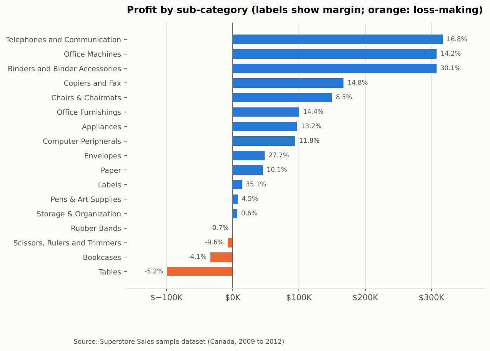
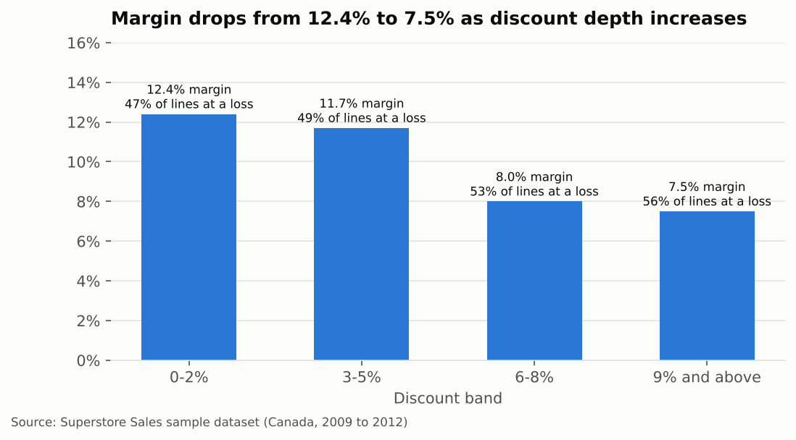
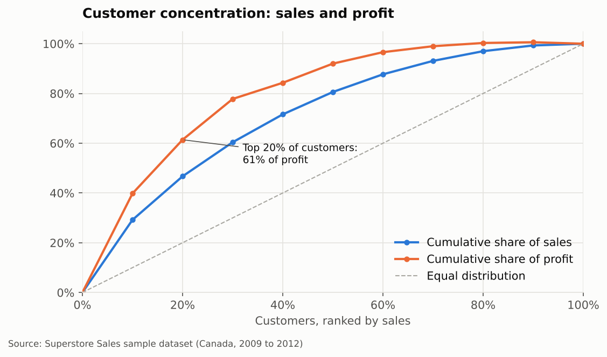

# Retail Profitability Analysis: Office Products Superstore

Profitability analysis of 8,399 order lines ($14.9M sales, 795 customers, 2009 to 2012) to find where a retailer makes and loses money. Built with SQL (DuckDB) and Python.

| | |
|---|---|
| **Industry** | Retail / Distribution |
| **Tools** | SQL (DuckDB), Python, pandas, matplotlib |
| **Techniques** | Data cleaning, profitability analysis, discount impact, customer concentration (Pareto), year-over-year trends, scenario analysis |
| **Data** | Superstore Sales sample dataset, Canada (8,400 rows, 21 fields) |

---

## 1. Business Questions

1. Which product categories and sub-categories create or destroy profit?
2. How does discounting affect margin?
3. How dependent is the business on its largest customers?
4. What is the profit impact of fixing the loss-making lines?

## 2. Key Findings

| # | Finding | Evidence |
|---|---|---|
| 1 | Furniture is 34.7% of sales but only 7.7% of profit (2.3% margin vs 14.8% for Technology). | `outputs/tables/03_category_summary.csv` |
| 2 | Tables and Bookcases lose $132.6K combined on $2.7M of sales. Tables alone is the second-largest sub-category by sales. | `outputs/tables/02_subcategory_profitability.csv` |
| 3 | Bringing Tables and Bookcases to break-even would raise total profit 8.7% (margin 10.2% to 11.1%) with no new sales. | `outputs/tables/08_loss_scenario.csv` |
| 4 | Margin drops from 12.4% at 0-2% discount to 7.5% at 9% and above, and the share of loss-making lines rises from 47% to 56%. | `outputs/tables/04_discount_impact.csv` |
| 5 | The top 20% of customers generate 47% of sales and 61% of profit. The bottom 10% are net loss-making. | `outputs/tables/06_customer_concentration.csv` |
| 6 | Delivery Truck orders run at a 4.3% margin vs 14.7% for Regular Air because 67% of truck sales are furniture. The gap is a product-mix issue, not a carrier issue. | `outputs/tables/07_ship_mode.csv` |
| 7 | Sales fell 15.7% in 2010 and recovered 8.2% in 2012, but 2012 margin was the lowest in the period (9.2%). | `outputs/tables/05_annual_trend.csv` |

**Recommendations:**

1. Review pricing, freight recovery, and discount authority for Tables and Bookcases before any volume growth in Furniture.
2. Cap discounts above 8% or require approval, since margin loss accelerates past that point.
3. Build a retention program for the top two customer deciles, which hold 61% of profit.

## 3. Results

### 3.1 Profit by sub-category



### 3.2 Discount impact



### 3.3 Customer concentration



## 4. Method

| Step | File | Description |
|---|---|---|
| Preparation | `src/prepare_data.py` | Converts the raw file (legacy CR line endings, Latin-1) to clean UTF-8 with snake_case columns. No business logic. |
| Staging | `sql/00_staging.sql` | Removes empty rows, corrects region typo, derives year, loss flag, and discount band |
| Data quality | `sql/01_data_quality.sql` | Row counts, duplicates, date logic, corrections applied |
| Profitability | `sql/02_subcategory_profitability.sql`, `sql/03_category_summary.sql` | Sales, profit, margin, loss-line rate, ranks |
| Discounting | `sql/04_discount_impact.sql` | Margin and loss rate by discount band |
| Trend | `sql/05_annual_trend.sql` | YoY growth with `LAG()`, average order value |
| Customers | `sql/06_customer_concentration.sql` | Customer deciles with `NTILE()` and running totals |
| Logistics | `sql/07_ship_mode.sql` | Margin by ship mode with category mix |
| Scenario | `sql/08_loss_scenario.sql` | Profit impact if loss-making sub-categories break even |

## 5. Data Quality

| Check | Result |
|---|---|
| Raw rows | 8,400 |
| Empty rows removed | 1 |
| Order lines analyzed | 8,399 |
| Distinct orders / customers | 5,496 / 795 |
| Duplicate row IDs | 0 |
| Ship date before order date | 0 |
| Region values corrected ("Prarie" to "Prairie") | 1,706 |

## 6. Limitations

- Sample dataset published for BI training. Figures demonstrate method, not a real company's results.
- No cost-of-goods or freight breakdown, so the cause of Furniture losses (pricing, freight, or damage) cannot be isolated.
- Discount and product category are correlated. Discount impact is descriptive, not causal.

## 7. Repository Structure

```
retail-sales-profitability-analysis/
├── data/
│   ├── raw/superstoreSales.csv
│   └── processed/superstore_sales.csv
├── sql/
│   ├── 00_staging.sql
│   ├── 01_data_quality.sql
│   ├── 02_subcategory_profitability.sql
│   ├── 03_category_summary.sql
│   ├── 04_discount_impact.sql
│   ├── 05_annual_trend.sql
│   ├── 06_customer_concentration.sql
│   ├── 07_ship_mode.sql
│   └── 08_loss_scenario.sql
├── src/
│   ├── prepare_data.py
│   ├── run_analysis.py
│   └── style.py
├── outputs/
│   ├── figures/
│   └── tables/
└── requirements.txt
```

## 8. How to Run

```bash
pip install -r requirements.txt
python src/prepare_data.py
python src/run_analysis.py
```

## 9. Data Source

Superstore Sales sample dataset (Canadian edition), originally distributed with Tableau training materials. Public copy: https://github.com/curran/data/tree/gh-pages/superstoreSales
